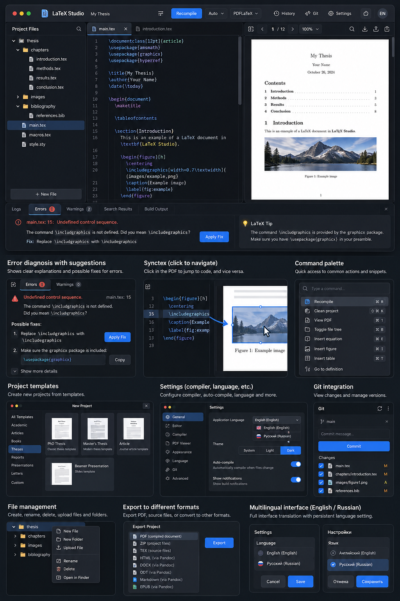

# LaTeX Studio — Product, UI/UX, Architecture & Implementation Plan

> **Purpose:** Build a polished, reliable, local-first macOS desktop LaTeX editor inspired by the productivity and workflow of Overleaf. This is an independent implementation: do not copy Overleaf branding, proprietary source code, or protected assets.
>
> **Primary user:** A student/researcher who wants to create and maintain LaTeX projects locally, compile them, inspect PDFs, diagnose errors, and export documents without needing a browser-based service.
>
> **Implementation language for this plan:** English.  
> **Application languages:** English and Russian, switchable at runtime.

---

## 0. Non-negotiable product principles

1. **Working software over mockups.** Every visible primary control must perform a real action. Do not leave dead buttons, fake success messages, hard-coded demo data in production paths, or placeholder menus.
2. **Local-first.** Projects live on the user's Mac. No account, cloud service, telemetry, or network connection is required for normal editing and compilation.
3. **Safe file handling.** Never overwrite a project, delete files, apply a fix, or run an arbitrary command without appropriate user consent. Use atomic saves where possible.
4. **Reliable compilation.** Run real TeX tools installed on the system. Capture exit codes, standard output/error, logs, and generated artifacts. Do not pretend compilation succeeded when it failed.
5. **Incremental implementation.** Build, run, and test each milestone before moving to the next. Keep the application launchable at all times.
6. **Modern, restrained UI.** Aim for a native-feeling macOS application: high-quality spacing, clear hierarchy, keyboard support, responsive resizable panes, accessible contrast, polished empty/loading/error states.
7. **No feature claims without implementation.** If a feature is not implemented, mark it as planned or disable it with an honest explanation.
8. **Preserve source fidelity.** The editor must not silently rewrite LaTeX source, line endings, encoding, comments, or whitespace.

## 1. Visual reference

The companion image `ui-reference.png` is the visual direction for the application. Use it as a guide to layout, density, dark theme, colors, and component style—not as a pixel-perfect screenshot to reproduce. Build the actual UI from reusable components, not by placing the reference image as a background.



### Visual design requirements

- Default theme: **Dark**; also support Light and System themes.
- Main workspace: three resizable columns:
  1. **Project/file tree** on the left.
  2. **LaTeX source editor** in the middle.
  3. **Compiled PDF preview** on the right.
- A resizable/collapsible bottom panel for Logs, Errors, Warnings, Search Results, and Build Output.
- Top toolbar for project name, Recompile, auto-compile toggle, engine selector, History, Git, Settings, Export, and language selection.
- Use restrained blue accents for the primary action, neutral dark surfaces, clear borders, consistent corner radii, and readable typography.
- The PDF page itself should remain white regardless of the app theme.
- Avoid excessive gradients, glowing borders, giant cards, decorative animation, or dashboard-style empty space. This is a work tool; prioritize clarity and information density.
- Support narrow window widths gracefully: allow hiding/collapsing panes, preserve the active editor, and never make controls overlap.
- Respect macOS window conventions, keyboard shortcuts, focus behavior, and native file dialogs.
- Add polished states for: no project open, empty project, first launch, missing TeX distribution, compilation in progress, compilation failed, no errors, no search results, export in progress, and permission/access failures.

### Suggested visual tokens

Use CSS variables/design tokens rather than scattered hard-coded values.

```css
:root {
  --bg-app: #17191e;
  --bg-panel: #20232a;
  --bg-elevated: #282c35;
  --border-subtle: #353a45;
  --text-primary: #f2f4f8;
  --text-secondary: #a9b1bf;
  --accent: #3478f6;
  --success: #35b779;
  --warning: #e7a23b;
  --danger: #f06464;
  --editor-bg: #171a20;
  --pdf-page: #ffffff;
  --radius-sm: 6px;
  --radius-md: 9px;
  --radius-lg: 12px;
}
```

These values are starting points, not immutable requirements. Ensure WCAG-conscious contrast and test both themes.

---

## 2. Recommended technology stack

### Desktop shell and backend

- **Rust** for native/system functionality.
- **Tauri 2** for the macOS desktop shell and frontend/backend bridge.
- Use the current stable versions compatible with one another; pin dependencies and document the chosen versions.
- Keep Tauri capabilities and permissions minimal. Do not grant broad filesystem or shell access to the webview without a clear need.
- Use typed, validated Tauri commands. Do not expose arbitrary shell execution to the frontend.

### Frontend

- **React + TypeScript**.
- **Vite** for development/build tooling.
- **CodeMirror 6** for source editing, with LaTeX support or a well-tested custom language configuration.
- **PDF.js** for the embedded PDF viewer.
- **i18next + react-i18next** for localization.
- Use a coherent icon set such as Lucide, with consistent stroke weight.
- Use CSS modules or a well-structured CSS system with design tokens. Avoid mixing several UI libraries without a strong reason.

### LaTeX compilation and conversion

- Detect installed **TeX Live/MacTeX** tools, especially `latexmk`, `pdflatex`, `xelatex`, `lualatex`, `bibtex`, and `biber`.
- Support **Tectonic** as an optional alternative engine if installed. Do not require it.
- Use **Pandoc** for supported conversions such as DOCX, HTML, ODT, EPUB, and Markdown. Detect whether it is installed and explain missing dependencies clearly.
- PDF export should use the actual compiled PDF.
- ZIP export should preserve the complete project structure and resources.
- Keep compiler and converter adapters separate from UI components so more engines/formats can be added later.

### Persistence

- Store application preferences in a versioned local configuration file.
- Keep user projects in their existing folders; do not force users to migrate them into an application-specific database.
- Use a small local metadata store only if needed for recent projects, workspace state, history metadata, and cached diagnostics.
- Do not store source content in a database unnecessarily.
- Add schema versioning and safe migration for application settings.

---

## 3. Application layout and components

### Main window

**Top toolbar**
- App icon and application name.
- Current project name and unsaved state.
- Recompile button with progress indicator.
- Auto-compile on/off control.
- Engine selector: pdfLaTeX, XeLaTeX, LuaLaTeX, and optional detected engines.
- History/versions.
- Git panel.
- Settings.
- Export menu.
- Language selector: English / Русский.

**Left pane — Project Files**
- Hierarchical file tree.
- Create file/folder, rename, delete, duplicate, reveal in Finder, and refresh.
- Import files/folders through a native file picker or drag-and-drop.
- File icons for `.tex`, `.bib`, images, `.sty`, `.cls`, and generic files.
- Context menu on files and folders.
- Show active file and modified state.
- Allow opening multiple files in tabs.
- Prevent path traversal and reject operations outside the project root unless the user explicitly imports/selects a file.
- Warn before deleting files and offer undo where feasible.

**Center pane — Source Editor**
- CodeMirror 6 with syntax highlighting, line numbers, active-line highlight, bracket matching, indentation, undo/redo, find/replace, and keyboard navigation.
- Multiple tabs and dirty-state markers.
- Preserve file encoding and line endings when possible.
- Configurable font size, font family, tab size, word wrap, and minimap only if it adds value.
- Show diagnostics in the gutter and inline where appropriate.
- Jump to compiler error locations.
- Snippets for common LaTeX structures.
- Basic completion for LaTeX commands, environments, labels, references, citations, and project files where feasible.
- Do not insert or alter text without explicit user action.

**Right pane — PDF Preview**
- Render the most recent successful PDF.
- Page navigation, zoom in/out, fit width, fit page, and current page indicator.
- Search text in PDF.
- Download/save/copy path to compiled PDF.
- Refresh automatically after successful compilation.
- If compilation fails, preserve the last successful PDF and clearly label it as **stale** instead of replacing it with a broken/empty view.
- Implement forward/backward source-to-PDF navigation using SyncTeX when available. If SyncTeX support is unavailable, explain that and keep basic preview working.
- Handle multi-page PDFs, large files, and loading failures.

**Bottom panel**
- Tabs: Logs, Errors, Warnings, Search Results, Build Output.
- Each diagnostic displays severity, message, source file, line/column if known, and a click target.
- Selecting a diagnostic navigates to the appropriate file and line.
- Provide filters and a clear way to collapse the panel.
- Do not show a success status until the compiler exits successfully and a valid output PDF exists.

---

## 4. Core feature requirements

### P0 — Essential release requirements

These features must work before calling the application a usable MVP.

#### Project lifecycle
- Open an existing project folder.
- Create a new blank project.
- Create a project from a local template.
- Open recent projects and remove entries from the recent list.
- Save files and autosave safely.
- Detect external file changes and offer reload/compare instead of silently overwriting.
- Handle paths with spaces, Unicode, and non-ASCII characters.
- Import/export a project as ZIP while preserving relative paths.
- Display a helpful first-run message if no TeX distribution is installed.

#### Editing
- Multiple source tabs.
- Syntax highlighting and line numbers.
- Save, undo/redo, find/replace.
- Keyboard shortcuts for common actions.
- Unsaved changes warning on close.
- No loss of source when compilation fails or the application closes unexpectedly.

#### Compilation
- Real compilation using installed tools.
- Configurable root/main `.tex` file.
- Engine selection.
- Working directory set safely to the project root or an isolated build directory with correct resource resolution.
- Capture logs and exit code.
- Display progress and allow cancellation where safely supported.
- Prevent concurrent builds for the same project or manage them deterministically.
- Debounce auto-compile to avoid launching a build for every keystroke.
- Auto-compile can be disabled.
- Avoid infinite build loops caused by generated files.
- Preserve the last successful PDF on failure.
- Recognize missing executable, missing package, missing bibliography tool, permission failure, timeout, and malformed source.
- Avoid shell-string command construction. Pass executable and arguments separately and validate paths/arguments.

#### PDF preview
- Embedded PDF.js viewer.
- Zoom, page navigation, text search, refresh, and fit modes.
- Automatic refresh after successful build.
- Clear stale-PDF status after failed build.
- Sensible error handling for invalid or missing PDF output.

#### Diagnostics and fix suggestions
- Parse common LaTeX log patterns into structured diagnostics.
- Detect file/line when possible and navigate to source.
- Explain the likely cause in plain language.
- Offer suggested fixes where confidence is adequate.
- Show the proposed source diff before applying a fix.
- Require explicit user confirmation before modifying files.
- Create an undoable edit or backup before applying a fix.
- Never claim a fix is guaranteed. Distinguish high-confidence deterministic fixes from heuristic suggestions.
- Keep original compiler messages available for debugging.

#### Localization
- Full English and Russian UI.
- Change language without restarting where feasible.
- Persist the selected language.
- Translate menus, dialogs, buttons, settings, empty states, status messages, tooltips, validation errors, export options, and diagnostic explanations.
- No hard-coded UI strings outside translation resources except unavoidable low-level errors with a localized wrapper.
- Use stable translation keys and a documented process for adding languages.
- Compiler output should remain available in its original language; display a localized explanation alongside it.
- Do not translate LaTeX commands, source code, file names, labels, citations, or technical identifiers.

#### Export
- Save compiled PDF.
- Export source/project ZIP.
- Export raw `.tex` and project resources.
- Offer DOCX, HTML, ODT, EPUB, and Markdown through Pandoc when available and compatible.
- Before conversion, show the output format and destination.
- Explain that non-PDF conversion can lose or alter complex LaTeX formatting.
- Never silently overwrite an existing export; ask before replacement.
- Report converter stderr and actionable errors.
- If Pandoc is absent, show installation guidance and keep PDF/source export available.

### P1 — Important secondary features

Implement these after P0 is stable.

- Project templates: article, report, book, thesis, presentation/Beamer, letter, blank project.
- A template gallery with preview, description, and license/source metadata for bundled templates.
- Snippets for sections, figures, tables, equations, matrices, lists, references, and bibliography.
- Insert-symbol/equation helper.
- Search across all project files.
- Word count and basic document statistics.
- Label/reference/citation assistance.
- Bibliography support for BibTeX and Biber workflows.
- Configurable compiler arguments and build options, with safe validation.
- Build output directory configuration and clean auxiliary files action.
- File watcher for external changes.
- History of saved versions with diff and restore.
- Git status, diff, stage, commit, and branch display using installed Git. Ask for confirmation for destructive operations; never silently run `reset --hard`, force-push, or discard changes.
- Optional spell-check integration if feasible and language dictionaries are available.
- Command palette with search and keyboard navigation.
- Customizable shortcuts.
- Settings for theme, editor font, font size, auto-compile delay, compiler, PDF behavior, and language.
- Recovery of unsaved buffers after a crash.
- Drag-and-drop images into a project with a prompt for destination and a generated `\includegraphics` snippet.
- Copyable diagnostics and build logs.
- A “Reveal in Finder” action.

### P2 — Advanced / future scope

Design extension points, but do not let these block the local-first release.

- AI-assisted debugging using a user-configured compatible API provider.
- AI explanations and proposed patches with a diff and explicit confirmation.
- Optional local model integration if a practical runtime is chosen.
- Collaborative editing, comments, cloud sync, accounts, and remote project hosting. These require security, synchronization, and backend design; do not simulate them as if already supported.
- More export targets or custom conversion pipelines.
- Advanced TeX language-server integration.
- Plugin/extension API only if there is a real use case and a secure architecture.

---

## 5. Error diagnosis and repair UX

This is a key differentiator. The application should help users understand errors, not only point at a line.

### Diagnostic presentation

For every parsed error or warning, show:
- Severity: error, warning, or information.
- File and line/column, if available.
- Original compiler message.
- Plain-language explanation in the current UI language.
- Likely cause and suggested next steps.
- Suggested fix, if one can be generated reliably.
- Confidence label such as **High confidence**, **Possible fix**, or **Needs investigation**.

Examples to support:
- Missing closing brace or unmatched environment.
- Undefined control sequence / misspelled command.
- Missing package.
- Missing image/file.
- Missing citation or reference.
- Duplicate labels.
- Undefined references after first compilation.
- Bibliography tool not run or configured incorrectly.
- Unicode/font errors with pdfLaTeX.
- Missing compiler executable.
- File permission or output-directory failure.

### Applying a fix

1. User selects a suggestion.
2. App shows a diff with the exact lines to be changed.
3. User selects **Apply Fix** or cancels.
4. App validates the target file is inside the project and has not changed since the suggestion was created.
5. App creates an undoable edit/backup and applies the patch.
6. App marks the file modified and offers/restarts compilation according to settings.
7. If the result is worse, the user can undo. Never automatically apply a chain of unreviewed fixes.

### AI integration

- AI assistance is optional and off until configured.
- Never require an API key for basic diagnostics.
- Never send source code, logs, file paths, or project metadata to a remote service without clear opt-in.
- Allow the user to choose what context to send: selected error, relevant lines, or log excerpt.
- Do not include secrets, environment variables, or unrelated project files in requests.
- AI output is untrusted. Validate patch ranges and show a diff before applying.
- Clearly disclose when a suggestion came from a heuristic rule versus an AI provider.
- Handle rate limits, network failures, malformed model output, and missing configuration gracefully.

---

## 6. Localization requirements

Use `i18next` and `react-i18next`. Example structure:

```text
src/
  i18n/
    index.ts
    locales/
      en/
        common.json
        editor.json
        diagnostics.json
        settings.json
      ru/
        common.json
        editor.json
        diagnostics.json
        settings.json
```

Requirements:
- English and Russian translations must be complete for every shipped UI flow.
- Use translation keys rather than text comparisons in logic.
- Use correct pluralization and locale-aware dates/numbers.
- The user can select language in first-run setup and Settings.
- Persist language selection locally.
- Ensure the layout supports longer Russian labels without clipping.
- Include tests that verify required translation keys exist in both locales.
- Keep technical identifiers and original compiler output unchanged, but localize explanatory copy.

---

## 7. Suggested project structure

Adapt this structure if a better reasoned organization is needed, but keep backend, frontend, domain logic, and platform integration separated.

```text
latex-studio/
├── README.md
├── PLAN.md
├── package.json
├── pnpm-lock.yaml
├── vite.config.ts
├── tsconfig.json
├── src/
│   ├── app/
│   │   ├── App.tsx
│   │   ├── routes.tsx
│   │   └── state/
│   ├── components/
│   │   ├── layout/
│   │   ├── toolbar/
│   │   ├── project-tree/
│   │   ├── editor/
│   │   ├── pdf-viewer/
│   │   ├── diagnostics/
│   │   ├── command-palette/
│   │   ├── dialogs/
│   │   └── settings/
│   ├── features/
│   │   ├── projects/
│   │   ├── compilation/
│   │   ├── export/
│   │   ├── history/
│   │   ├── git/
│   │   ├── templates/
│   │   └── diagnostics/
│   ├── i18n/
│   ├── hooks/
│   ├── services/
│   ├── styles/
│   ├── types/
│   └── test/
├── src-tauri/
│   ├── Cargo.toml
│   ├── tauri.conf.json
│   ├── capabilities/
│   ├── icons/
│   └── src/
│       ├── main.rs
│       ├── lib.rs
│       ├── commands/
│       ├── domain/
│       ├── project/
│       ├── compiler/
│       ├── diagnostics/
│       ├── export/
│       ├── history/
│       ├── git/
│       ├── settings/
│       └── platform/
└── tests/
    ├── fixtures/
    ├── integration/
    └── e2e/
```

Do not create empty files just to match this tree. Each module should have a clear responsibility and tests where practical.

---

## 8. Architecture and safety boundaries

### Frontend/backend boundary

Expose typed commands such as:
- `open_project`
- `create_project`
- `list_project_files`
- `read_project_file`
- `write_project_file`
- `create_project_file`
- `rename_project_file`
- `delete_project_file`
- `compile_project`
- `cancel_compilation`
- `get_build_status`
- `get_diagnostics`
- `export_project`
- `get_app_settings`
- `update_app_settings`
- `get_recent_projects`
- `get_git_status`
- `get_file_history`

Names may be adjusted, but commands must have typed inputs/outputs and explicit error types. Never expose a generic `execute_command(command_string)` function to the frontend.

### Filesystem safety

- Canonicalize and validate paths before file operations.
- Prevent `../` traversal and symlink escapes outside the authorized project root.
- Use explicit user selection for project roots and import/export destinations.
- Avoid deleting arbitrary directories or following unexpected symlinks.
- Use atomic writes or temporary-file replacement for saves.
- Confirm destructive actions.
- Keep project-relative references working.
- Handle Unicode paths and spaces correctly.

### Process execution

- Spawn compiler/converter executables directly with argument arrays, not a shell-concatenated string.
- Detect executables and versions.
- Capture stdout, stderr, exit code, duration, and cancellation status.
- Apply a reasonable timeout and allow cancellation when supported.
- Do not kill unrelated user processes.
- Avoid concurrent build races.
- Make build outputs and temporary directories deterministic and documented.
- Never claim a build succeeded based only on the presence of an old PDF.

### Secrets and privacy

- No telemetry by default.
- No cloud dependency for core functionality.
- Never log API keys or sensitive environment variables.
- AI network calls require opt-in and a clear disclosure of the data being sent.
- Treat project content, compiler logs, and AI output as untrusted input.

---

## 9. State management and reliability

- Use a predictable frontend state model; avoid duplicating authoritative state between React and Rust.
- Rust should be the source of truth for filesystem operations and build status.
- Use event subscriptions for compilation progress and diagnostics, and clean them up on unmount.
- Track dirty buffers separately from on-disk files.
- Debounce auto-compilation and cancel/ignore stale build results safely.
- Prevent a slower older build from overwriting a newer build's preview.
- Preserve the last successful build artifact if the newest build fails.
- Save workspace state such as open tabs, active file, pane sizes, and recent projects.
- Recover unsaved edits after a crash when feasible.
- Make errors actionable; avoid generic “Something went wrong” when the underlying cause is known.

---

## 10. Testing strategy

Do not treat “the app opens” as sufficient.

### Unit tests
- Path validation and project-root boundaries.
- Diagnostic log parsing with fixtures from different engines.
- Translation key parity between English and Russian.
- Export format availability and error handling.
- Settings serialization and migration.
- Debounce/build state logic.
- Patch validation and conflict detection.

### Integration tests
- Create/open/save project.
- Compile a minimal valid document with an installed engine.
- Compile a document with a syntax error and parse the expected diagnostic.
- Verify the last successful PDF remains available after a failed compile.
- Export PDF and ZIP.
- Run supported Pandoc conversions when installed; skip clearly when the dependency is unavailable.
- Test spaces and Unicode in project paths.
- Apply and undo a suggested fix.
- Detect an external file change without silently discarding editor changes.

### UI/e2e tests
- Open project, edit source, compile, inspect PDF.
- Switch English/Russian and verify language persists after restart.
- Resize/collapse panes and reopen them.
- Use file tree context menu.
- Navigate from an error to the relevant line.
- Review a fix diff and cancel/apply it.
- Export to a chosen destination.
- Verify keyboard focus and common shortcuts.

### Manual acceptance on macOS
- Test on Apple Silicon.
- Test with TeX Live/MacTeX installed.
- Test when TeX is missing.
- Test when Pandoc is missing.
- Test light, dark, and system themes.
- Test large documents and projects with images/bibliographies.
- Test file names containing spaces and Cyrillic.
- Test packaging, signing/notarization guidance, and a clean install.

---

## 11. Milestones and implementation order

Implement in small, verified increments. Do not attempt to generate the whole application in one giant code dump.

### Milestone 0 — Repository and environment
- Inspect the existing repository before changing anything.
- If it is empty, scaffold Tauri 2 + React + TypeScript.
- Write setup instructions and dependency requirements.
- Add formatting, linting, type-checking, and test scripts.
- Ensure `dev` mode launches and a macOS build can be produced.
- Commit or checkpoint the baseline if Git is available.

**Exit criteria:** the app launches locally and the README explains how.

### Milestone 1 — Visual shell
- Implement the main window, toolbar, three-pane layout, bottom diagnostics panel, dark/light/system themes, and responsive pane resizing.
- Use real components and local state.
- Add empty states and mock fixtures only inside development/test code.
- Implement English/Russian switching and persist it.

**Exit criteria:** polished UI shell; all controls have defined actions or are visibly disabled as not implemented.

### Milestone 2 — Project/file management
- Open/create project, tree view, file tabs, file operations, safe save, recent projects, and workspace persistence.
- Add file dialogs and import/drop behavior.

**Exit criteria:** users can open and edit a real local project without data loss.

### Milestone 3 — Code editor
- Integrate CodeMirror 6, LaTeX highlighting, editing basics, search/replace, dirty state, snippets, and keyboard shortcuts.
- Connect diagnostics to editor locations.

**Exit criteria:** editing is reliable and comfortable for a multi-file LaTeX project.

### Milestone 4 — Compiler and PDF
- Detect TeX tools.
- Implement compilation, logs, cancellation, build status, and PDF.js preview.
- Add engine selection, auto-compile, stale-PDF handling, and SyncTeX where feasible.

**Exit criteria:** a real document compiles and the resulting PDF updates correctly.

### Milestone 5 — Diagnostics and safe fixes
- Parse common errors and warnings.
- Show localized explanations and suggested fixes.
- Implement preview diff, explicit confirmation, validation, undo, and recompile.

**Exit criteria:** common errors are actionable and fixes cannot silently damage source.

### Milestone 6 — Export and templates
- Implement PDF, TEX/source, ZIP, and Pandoc-based formats.
- Add template gallery and project creation flows.
- Add dependency detection and clear conversion limitations.

**Exit criteria:** exports are real, validated, and saved to user-selected destinations.

### Milestone 7 — History, Git, and secondary features
- Implement version history/diff/restore and Git status/diff/commit.
- Add cross-project search, reference assistance, word count, and other P1 features in priority order.

**Exit criteria:** features are tested and do not destabilize P0 workflows.

### Milestone 8 — Polish and release readiness
- Performance and memory profiling.
- Accessibility and keyboard pass.
- Error-state and recovery pass.
- Full English/Russian pass.
- Build/package instructions for Apple Silicon and Intel Macs if feasible.
- Signing/notarization documentation.
- Final regression suite.

**Exit criteria:** fresh setup, build, launch, core workflow, export, and failure recovery are documented and tested.

---

## 12. Definition of Done

A feature is not complete until:
- It works against real project data.
- It has loading, empty, success, and failure states as applicable.
- It respects filesystem and process safety.
- It is localized in English and Russian.
- It has tests appropriate to its complexity.
- It has no dead buttons or fake success states.
- It is documented in the README or in-app help where needed.
- It does not regress existing core workflows.

The application is not ready to call a functional release until a user can:
1. Launch it on macOS.
2. Open or create a real LaTeX project.
3. Edit multiple files and save safely.
4. Compile a real document with an installed TeX engine.
5. View and navigate the generated PDF.
6. See a meaningful error when compilation fails.
7. Get a clear explanation and review a proposed fix.
8. Apply or reject the fix safely.
9. Export the PDF and source project.
10. Switch between English and Russian.
11. Close and reopen the application without losing saved project state.

---

## 13. What to do first

Before implementing, inspect the repository and report:
- Current files and architecture.
- Available Rust, Node.js, package manager, Xcode Command Line Tools, TeX Live/MacTeX, and Pandoc versions.
- Any existing code that must be preserved.
- Any platform/tooling blockers.

Then propose a short implementation checklist for Milestone 0 and Milestone 1. Proceed with implementation after the inspection; do not stop at a plan-only response.

Keep the plan updated as features are completed. Do not mark a feature done until it has been implemented and tested. If a dependency is unavailable, implement graceful detection and document the exact setup step instead of faking functionality.

---

## 14. Implementation progress — verified

### Completed

- Shared Rust project index: multi-file headings, labels, references, citations from `.bib`, includes, files, images, packages, and floats.
- Regex/case-capable search; project-wide replace with preview, confirmation, `pre-replace` checkpoint, stale token validation, atomic writes, rollback, BOM/CRLF preservation.
- Activity rail with persistent Project / Search / Outline; search results; include-aware outline with figures/tables/equations.
- Contextual autocomplete for commands, environments, labels, citations, includes, images, packages, and snippets.
- Command palette (`⌘K`) with project, build, navigation, view, insert, theme, language, doctor, and help commands.
- Project checkpoint history: content-addressed blobs, manifests, baseline/post-save checkpoints, named checkpoints, exact timestamps, A/M/D/R statuses, +/− line counts.
- History panel with date/time ranges, Today/7/30/All, newest/oldest, text and filename search, type filters, empty states.
- Read-only restore preview with colored line-numbered diff, binary state, change/file navigation, banner, cancel, and real tree highlighting.
- Transactional single/full restore with token validation, recovery checkpoint, known-path deletion, atomic writes, rollback, post-restore verification.
- Configurable retention 10–500; `pre-fix`, `pre-delete`, `pre-rename`, `pre-replace` recovery checkpoints; legacy per-file history removed.
- Island-style left tree and right history cards with inset spacing, rounded borders, badges, folder counts, and persistent panel sizes.
- Project Doctor static analysis: duplicate labels, unresolved refs, missing citations/includes/images, unused images and `.tex` files, circular includes, malformed structures, confidence levels.
- Doctor tab with health summary, compiler+static merge, severity separation, navigation, and confidence badges.
- Real SyncTeX: native parser, Tectonic `--synctex`, forward/reverse search, included-file mapping, preserved last-success mapping, marker, `⌘⇧J`, Cmd+click.
- Native macOS undo/redo menu integration and custom configurable shortcuts.
- Equation builder with KaTeX preview, structure/calculus/relations/Greek/layout palettes, matrices, aligned, systems, nesting, and safe replacement confirmation.
- Table builder with editable grid, rows/columns, alignment, booktabs/hline/none, merge/unmerge, tabular/longtable, CSV import, escaping, preview, and replacement confirmation.
- Snippets for sections, figures, tables, equations, matrices, lists, references, citations, bibliography, and environments.
- Book template with parts/chapters; Book, Article, Report, Thesis, Beamer, Letter, and Blank templates with descriptions/licenses.
- PDF fit width/page, continuous lazy scrolling, text search, save/reveal, stale banner, SyncTeX, position preservation across rebuilds and restarts.
- Configurable build directory, clean auxiliary command, clean build, crash buffer recovery, stats, focus mode, spellcheck, image drag-and-drop, BibTeX/Biber help, unused-file detection, searchable settings.
- EN/RU runtime localization with parity test; dark/light/system; responsive narrow-window clamping.
- Release 1.0.0: app + DMG built, mounted and verified, installed at `~/Applications/LaTeX Studio.app`, checksums recorded.

### Verified

- `cargo test`: **34 passed, 4 ignored**.
- `npm test`: **16 passed** (format, equation, table, i18n parity, shortcuts).
- Ignored Tectonic tests passed on demand: real compile with SyncTeX, Book template compile, real-project Doctor.
- `npm run typecheck`: passed.
- `npm run build`: passed (KaTeX fonts and PDF worker emitted).
- Biome: no errors; CSS/snippet warnings remain.
- DMG mounted; Applications link and app executable checksum verified.
- Standalone app launched from `~/Applications/LaTeX Studio.app`; app data preserved.
- Real Tectonic compile of the user's project was verified with bundled Biber 2.17 and Latin Modern fonts.

### Known limitations / remaining acceptance

1. Manual visual QA of history, Doctor, SyncTeX, equation/table editors, island layout, EN/RU, and narrow windows requires the user; Screen Recording is denied in this environment.
2. Project refresh uses revision polling rather than FSEvents.
3. Overfull hbox and missing package/tool remain compiler diagnostics rather than separate Doctor categories.
4. Notarization requires an Apple Developer ID; the shipped DMG is ad-hoc signed.

